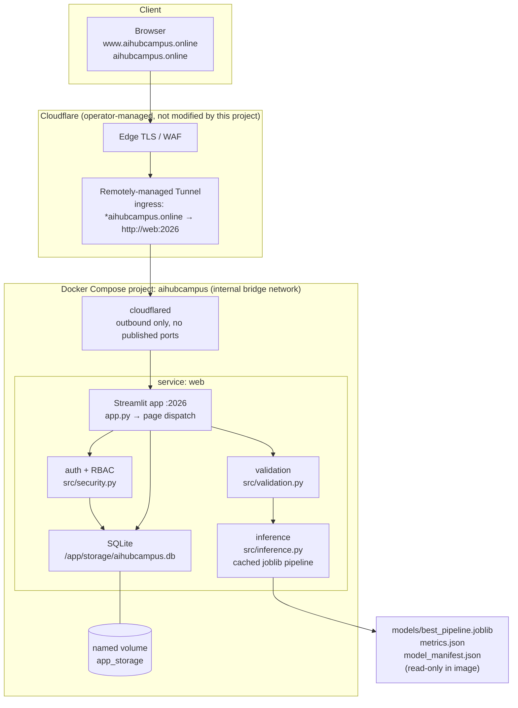

# Architecture — AI Hub Campus credit card default risk prediction

Status: **design frozen in Sprint 0**; **Sprint 1 adds the container skeleton** (§11) —
a branded shell and a health probe, with no authentication, database or model. Anything
here describing behaviour beyond that is a specification, not a claim that it runs.
Deviations from `blueprint.md` are recorded in §9.

## 1. Purpose and boundary

A single-instance academic decision-support web application. A signed-in user submits
23 historical attributes of a credit-card account and receives a binary next-month
default prediction, an uncalibrated model probability, a display tier and supportive
recommendations. Admins manage users, dataset versions and view the real ML evidence.

Explicitly **not** in scope: automated lending decisions, credit scoring, customer
contact, real customer data, registration, email, multi-tenant hosting. Historical
Taiwanese 2005 data, amounts in **NTD**, no claim of fitness for current Malaysian
lending.

## 2. Runtime topology



Text form (for reviewers without a Mermaid renderer):

```text
Browser --HTTPS--> Cloudflare edge --> remotely-managed tunnel (outbound only)
        --> cloudflared container --internal network--> web:2026 (Streamlit)
        --> session/RBAC guard + 23-field validation
        --> cached joblib Pipeline (fixed feature order) --> class + predict_proba
        --> tier/recommendation mapping --> SQLite (users, dataset_versions,
            prediction_logs, audit_events, schema_migrations)
```

Offline / reproducible ML path (no runtime training):

```text
data/UCI_Credit_Card.csv --validate(S2)--> EDA(S3) --> stratified 80/20 split(S4)
  --> 3 pipelines (LR, DT depth 5, RF 100×depth 5) --> held-out evaluation(S4)
  --> selected artifact + metrics.json + manifest(S5) --> app loads read-only(S5+)
```

## 3. Components and responsibilities

| Component | Path | Responsibility | Sprint |
|---|---|---|---|
| Entry point / dispatch | `app.py` | Navigation, session check on every route | S1/S6 |
| Config | `src/config.py` | Typed env settings, no defaults for secrets | S1 |
| DB layer | `src/db.py` | SQLite connection, WAL, idempotent migrations | S6 |
| Security | `src/security.py` | Argon2id/bcrypt hashing, session, RBAC, login throttling | S6 |
| Validation | `src/validation.py` | 23-field contract, CSV schema/ranges | S2/S5 |
| Inference | `src/inference.py` | Load manifest-verified pipeline once, predict | S5 |
| Recommendations | `src/recommendations.py` | Deterministic tier → advice mapping | S5 |
| Dataset manager | `src/data_manager.py` | Quarantine, checksum, version, activate | S9 |
| Charts | `src/charts.py` | Render saved EDA/performance figures | S10 |
| Audit | `src/audit.py` | Append non-sensitive admin events | S8 |
| ML scripts | `ml/*.py` | Inspect, EDA, train, evaluate, verify artifact | S0/S2–S5 |

Single instance of app + SQLite by design: avoids concurrent-session ambiguity on a
school demo. No horizontal scaling, no external queue, no second datastore.

## 4. Technology choices

| Layer | Choice | Why | Rejected |
|---|---|---|---|
| Runtime | Python 3.12 (pinned base image) | Streamlit/scikit-learn support, reproducible | Node/Next.js (no-go) |
| UI | Streamlit, pinned release | Fast multipage academic UI, Python-native | React SPA, FastAPI split backend (no-go) |
| ML | scikit-learn `Pipeline`, joblib | Leakage-safe preprocessing, single artifact | TensorFlow/LLM/paid APIs (no-go) |
| Data/EDA | pandas, NumPy, matplotlib | Standard, regenerable plots | Notebook-only deliverable (brief §10 forbids) |
| Storage | SQLite on a named volume | Zero-ops, sufficient for one instance | PostgreSQL, Redis (no-go) |
| Auth | `argon2-cffi` (bcrypt fallback) | Modern hashing, constant-time verify | Bare SHA-256 (prohibited by blueprint §12.2) |
| Tests | pytest + Streamlit `AppTest` | Objective gates, runnable in CI | Manual-only verification |
| Deploy | Docker Compose + `cloudflare/cloudflared` | Reproducible, no public port | Kubernetes (no-go), host port exposure (no-go) |

Exact pins land in `requirements.txt` at S1; this table records intent only.

## 5. Ingress resolution — the port 2026 decision

**The fact.** The operator's Cloudflare tunnel already publishes **both**
`www.aihubcampus.online` and `aihubcampus.online` to **`http://web:2026`**. `blueprint.md`
§2/§7 instead specify `http://web:8501`, and its compose file, healthcheck and Dockerfile
command hard-code 8501.

Provenance: operator report on issue RIDEGAMI-798, repeated in the operator's own record
(`PROJECT_DETAILS.md`, git-ignored): both hostnames → `http://web:2026`, default 404. It is
**not independently verified in S0** — the tunnel is remotely-managed, no local ingress
config exists (`~/.cloudflared` is empty), and inspecting it would need Cloudflare API
credentials.
S0 therefore treats the ingress as immutable and unverified, and S13 confirms it against
the live domain.

**Options considered.**

| Option | What it needs | Verdict |
|---|---|---|
| A. Serve Streamlit on **2026** | App port changed in one place; no Cloudflare change | **Chosen** |
| B. Keep 8501, edit the tunnel route to `http://web:8501` | Cloudflare dashboard/DNS change | Rejected — DNS/tunnel modification is out of scope and unauthorised |
| C. Keep 8501, add a proxy container mapping `web:2026 → web:8501` | An extra container and a second failure point | Rejected — complexity for no benefit |

**Decision (A).** The application serves on **2026**:

- `APP_PORT=2026` is the single source of truth; `.streamlit/config.toml`
  (`server.port`), the Dockerfile `CMD`, `EXPOSE`, the compose `expose:` entry and the
  healthcheck URL all derive from it. Reconciling to 8501 at S13, if the observed ingress
  turns out to be 8501, is a one-value change in `.env`, not a refactor.
- The compose **service name stays `web`** because the ingress target is the Docker DNS
  name `web`. Renaming it would break the route.
- `expose: 2026` only. **No `ports:` section** — no public host port, ever.
- The healthcheck hits `http://127.0.0.1:2026/_stcore/health`.

**Apex and www.** Both hostnames reach the same service, so the app must not assume one
canonical host:

- Do **not** pin `browser.serverAddress`; Streamlit derives it from the request `Host`
  header, which keeps XSRF/CORS origin checks correct for whichever name is used.
  *(Superseded in S1 — see the amendment at the end of this section: the S1 card requires
  the pin, and both hostnames were re-verified as reachable with it in place.)*
- No apex→www redirect is needed or configured (Cloudflare already routes both).
- S13 must test login, upload and a prediction over **both** hostnames.

**Risk if the report is wrong.** If the real route is `8501`, the symptom is a 502/1033
at the edge while the container is healthy. S13 detects it in one curl; the fix is the
`APP_PORT` value. Nothing else in the design depends on the number.

**S1 amendment — `browser.serverAddress` / `browser.serverPort` are pinned.** The S1 card
requires `browser.serverAddress=www.aihubcampus.online` and `browser.serverPort=443` in
`.streamlit/config.toml` (blueprint §2 asks for them "if required for proxy support"), so
they are set. They change only the URL Streamlit *reports* (`docker compose logs web` shows
`URL: http://www.aihubcampus.online:443`); where the socket binds is still `server.address`,
and S1 verified below that both hostnames still reach the app.

```text
GET http://web:2026/_stcore/health                        -> 200 ok
GET http://web:2026/ with Host: www.aihubcampus.online    -> 200
GET http://web:2026/ with Host: aihubcampus.online        -> 200
```

Both hostnames therefore still reach the app with the values pinned
(`evidence/s1/ingress_target.txt`). S13 must re-test login, upload and a prediction over
both hostnames in a real browser; if the apex turns out to be affected there, deleting the
two `[browser]` keys is the whole fix.

## 6. Data flow and storage

- `users(id, username UNIQUE, display_name, password_hash, role CHECK(admin|user),
  is_active, created_at, updated_at, last_login_at)` — plus `must_change_password` (S6):
  a temporary password cannot be used for anything except setting a new one. Username
  uniqueness is case-insensitive, via a unique index on `lower(username)`.
- `prediction_logs(id, user_id, predicted_class, default_probability, risk_tier,
  model_version, created_at)` — **no raw feature snapshot** by default; history is
  pseudonymous by user ID.
- `dataset_versions(id, original_filename_safe, sha256 UNIQUE, record_count,
  column_count, class_zero, class_one, validated_at, activated_at, is_active,
  uploaded_by, status)` — exactly one active row, enforced in a transaction.
- `audit_events(id, actor_user_id, action, entity_type, entity_id, created_at,
  non_sensitive_details)`
- `sessions(token_hash PRIMARY KEY, user_id, created_at, expires_at, last_seen_at,
  revoked_at)` — the server-side session (S6). The key is the SHA-256 of the bearer token,
  so the table cannot be replayed as a credential; sign-out and deactivation are UPDATEs.
- `login_attempts(id, username_lower, attempted_at, succeeded)` — the brute-force counter
  (S6). Rows age out of the window, so a lock expires without a reset job.
- `schema_migrations(version, applied_at)`
- DB at `/app/storage/aihubcampus.db` on the `app_storage` volume; WAL + 5 s busy timeout,
  `foreign_keys=ON`, `BEGIN IMMEDIATE` for writes (§14).
- Model artifacts are baked read-only; the app never writes `models/`.

## 7. Data sensitivity and threat model

**Assets.** Operator credentials (admin password, session secret, tunnel token) ·
password hashes · prediction logs · dataset versions · the model artifact · the SQLite
file · the Cloudflare tunnel identity.

**Data sensitivity.** The benchmark dataset is public, aggregated, 2005-era and
**pseudonymous** — `ID` is a sequential index, not a customer identifier. That lowers
dataset risk but not system risk: the app stores credentials and behavioural logs. No
real customer record may ever be entered into the form; demo rows are synthetic and
labelled.

**Actors.** Anonymous internet user · authenticated User · Admin · operator (host +
Cloudflare) · the model artifact supply chain.

| # | Threat | Vector | Control | Residual |
|---:|---|---|---|---|
| T1 | Credential stuffing / brute force on login | Public login form | Argon2id hashes, constant-time verify, SQLite-backed attempt counter with expiry, generic error text | No MFA (out of scope); rate limit is per-instance |
| T2 | Privilege escalation User → Admin | Direct URL / forged session state | Server-side session + role check inside **every** privileged function, not just navigation; `Streamlit` session state is never the sole authority | None accepted; verified by T03 |
| T3 | Session hijack | Cookie theft over shared device | Signed session, expiry, logout invalidation, `enableXsrfProtection=true`, HTTPS only via tunnel | No device binding |
| T4 | Secret disclosure | Logs, `docker inspect`, git, screenshots | Secrets only in operator `.env` (mode 600, git-ignored); never logged or echoed; redaction in evidence; `git grep` gate | Host root can read env — accepted, host is single-tenant |
| T5 | Malicious CSV upload | Admin dataset upload | Size cap (10 MB), extension + MIME + **parse/schema** validation, quarantine path with generated filename, never executed, never auto-retrains | Admin is trusted; upload is still non-executable |
| T6 | Untrusted model artifact | Replacing `joblib` | Artifacts built only by trusted repo code; manifest + checksum verified at load; no upload path for pickles | Supply-chain risk in pinned packages |
| T7 | SQL injection | Any DB access | Parameterised queries only | — |
| T8 | Public origin exposure | Direct port access bypassing Cloudflare | `expose:` only, no `ports:`; single internal network; no host bind | Host-level firewall is the operator's control |
| T9 | Data exfiltration via prediction history | User reads others' rows | Queries filtered by session user ID server-side; admin sees aggregates, not raw features | Admin is trusted by design |
| T10 | Unfair or harmful output | Demographic features driving advice | Outputs framed as supportive, human-review-first; demographic ablation discussed in the report; no automated adverse action; disclaimer on every result | Fairness is **not** proven — must be stated as a limitation |
| T11 | Log leakage of sensitive input | Debug logging of 23 features | Never log submissions, credentials, hashes, cookies or tokens; 30-day retention default | — |
| T12 | Denial of service / cost | Public form abuse | Cloudflare edge protection; single instance is intentionally not HA | Availability is best-effort for an academic demo |

**Compliance stance.** No personal data is collected from users beyond a username;
no identity or banking account data is requested. The dataset is public and cited. The
system is a teaching artefact, not a regulated credit-decision system, and says so on
every screen.

## 8. Scope exclusions (binding)

No Next.js/React, no separate FastAPI backend, no PostgreSQL, no Redis, no Kubernetes,
no Celery, no LLM, no paid ML APIs, no registration/email, no training during a
prediction request, no `pickle`/`joblib` uploads, no public host port, no DNS or tunnel
change by this project, no writes outside `/home/ec-user/non_prod/hafyz_ds`, no Docker
project other than `aihubcampus`.

## 9. Deviations from `blueprint.md` (recorded as required by §3)

| # | Blueprint says | This project does | Why |
|---:|---|---|---|
| D1 | App on `:8501`, healthcheck on 8501 | `APP_PORT=2026` everywhere | Observed ingress targets `web:2026` (§5) |
| D2 | Password hashing "argon2-cffi **or** bcrypt" | Argon2id via `argon2-cffi` | One algorithm, one code path, easier to test |
| D3 | `PAY_1` implied by "six status columns" naming | `PAY_0, PAY_2…PAY_6` exactly as the CSV | The dataset has no `PAY_1`; inventing one would break the contract |
| D4 | Dataset described as all-integer monetary columns | Monetary columns read as float-safe, whole-NTD values | 4,262 cells use scientific notation (see `docs/report_evidence.md`) |
| D5 | Six EDA plots as a fixed list | Same six; captions must state the actual observed numbers | Draft's education "others" figure was wrong (C7) |
| D6 | §2: pin `browser.serverAddress`/`serverPort` only "if required" | Pinned to `www.aihubcampus.online` / `443` | Required by the S1 card; both hostnames re-verified reachable with the pin (§5 amendment) |
| D7 | §7 compose: `networks: internal: driver: bridge` | Same, plus `ipam` subnet `10.202.0.0/24` | The host daemon's predefined address pools are exhausted, so an implicitly-subnetted network cannot be created (§11) |
| D8 | §7 compose: `cloudflared` reads `${TUNNEL_TOKEN:?}` | `cloudflared` reads `.env.cloudflared` via `env_file` with `required: false` | `${TUNNEL_TOKEN:?}` makes `docker compose config` fail when the token is absent; the app must build and run without any Cloudflare credential (§11) |
| D9 | §4: "avoid over-restricting to observed min/max without documenting choice" | Dataset validation enforces hard floors/ceilings only (`PAY_AMT* >= 0`, `LIMIT_BAL >= 1`, `18 <= AGE <= 100`); the UI form uses the documented bands `LIMIT_BAL` 10,000–1,000,000 and `AGE` 18–100 | The observed range is descriptive, not a contract; a legitimate future upload must not be rejected for being outside 2005's sample (§12) |
| D10 | §4: "validate against actual observed data and accepted source semantics" for `PAY_*` | Legal set is −2…9, i.e. the observed −2…8 plus code 9 ("nine months or more") from the source's documented scale | Rejecting 9 would reject a value the source scale defines; accepting it changes nothing in the seed (§12) |
| D11 | §3 layout: `ml/` is tooling beside the app; the Dockerfile copied only `app.py` and `src/` | The image also copies `ml/` (contract module only) | `src/validation.py` imports the contract from `ml/schema.py`; one definition of the schema beats two copies (§12) |
| D12 | §6 lists five tables | Two more: `sessions` and `login_attempts` | A server-side session with expiry/revocation and a throttle that survives a process restart need storage. Redis is a no-go (§0), and a signed cookie alone cannot be revoked on deactivation (§14) |
| D13 | §2/§6: password policy "8–12+ characters"; the operator password is operator-chosen | Policy is 12 characters for *new* passwords; the seeded operator admin is created with `must_change_password = 1` because the supplied password is 7 characters | The weak operator password is a fact of the brief, not something to hide: the account works once, then can do nothing but set a compliant password. Silently accepting it, or rewriting the operator's `.env`, would both be worse (§14) |
| D14 | §3 layout: `scripts/` is tooling; the image copies only app code | `scripts/` is copied into the image | `scripts/init_admin.py` must run inside the container (`docker compose exec web python scripts/init_admin.py`) to reach the SQLite file on the volume; it reads credentials from the environment and prints none (§14) |

## 10. Open decisions deferred to later sprints

- ~~Exact Streamlit/sklearn pins (S1)~~ — resolved in S1: `requirements.in` (direct) →
  `requirements.txt` (fully pinned lock, 54 entries) on Python 3.12; see §11.
- ~~Session lifetime and expiry policy~~ — resolved in S6: an absolute 8-hour server-side
  session, revoked on sign-out and on deactivation; no sliding renewal (§14).
- ~~The weak operator password~~ — resolved in S6 (D13): seeded with
  `must_change_password = 1` rather than accepted silently (§14).
- Whether the optional `127.0.0.1:2026` troubleshooting bind is enabled (S12, off by default).
- Model selection if reproduction differs from the draft's Decision Tree (S4) — decided on
  F1 and default-class recall, never accuracy alone.
- Retention purge for `audit_events` / `prediction_logs` beyond the throttle's own pruning
  (S12), and the backup/restore drill mechanics (S12).

## 11. S1 implementation record — container skeleton

**What exists now.** `app.py` renders the branded shell and an inert sign-in form;
`src/config.py` is the typed, non-secret settings loader; `Dockerfile`, `compose.yaml`,
`.streamlit/config.toml`, `.env.example`, `.env.cloudflared.example` and `.dockerignore`
define the runtime. There is still no authentication, no database, no model and no dataset
in the image.

**Container facts, each captured in `evidence/s1/`.**

| Fact | Value | Evidence |
|---|---|---|
| Base image | `python:3.12-slim`, Python 3.12.14 | `image_contents.txt` |
| Runtime user | `app` (uid/gid 1001), non-root | `health_inside.txt` |
| Listening port | `2026` (`EXPOSE 2026`, `expose: 2026`, no `ports:`) | `image.txt`, `compose_config.txt` |
| Host port mapping | none — `docker port` empty, `NetworkSettings.Ports = {"2026/tcp":null}` | `no_host_port.txt` |
| Health | `/_stcore/health` → `200 ok` from inside the container and from a peer container on the network | `health_inside.txt`, `ingress_target.txt` |
| Image contents | `/app` = `.streamlit`, `app.py`, `requirements.txt`, `src/`, `storage`; no `.env`, no `.db`, no dataset | `image_contents.txt` |
| Tests | 11 passed (settings + shell) | `pytest.txt` |
| Clean checkout | `git archive` of the branch into an empty dir → `docker build --no-cache` succeeded (5m30s), `compose config --quiet` exit 0, 11 tests pass | `clean_checkout.txt` |
| Shell behaviour | submitting the form produces a warning only: 0 success, 0 error, no credential echoed | `apptest.txt` |

**Host constraint — the pinned subnet (D7).** On `ridergami2` the Docker daemon's predefined
address pools are fully subnetted by the other ~40 networks on the host, so creating the
project network implicitly fails:

```text
$ docker network create aihubcampus-s1-probe
Error response from daemon: all predefined address pools have been fully subnetted
exit=1
```

`compose.yaml` therefore pins `10.202.0.0/24` for `internal`. The range sits outside the
daemon's default pools (`172.16.0.0/12`, `192.168.0.0/16`), so it cannot be handed to a
later stack, and it overlapped none of the host's other networks — the check records
`overlaps=0` in `evidence/s1/network_constraint.txt`. This is a project-local compose
setting; no daemon configuration was touched. If the host is ever re-subnetted, the value
is one line.

**Tunnel token handling (D8).** `cloudflared` gets `TUNNEL_TOKEN` from `.env.cloudflared`
through an `env_file` entry marked `required: false`. Consequences: `docker compose config
--quiet` and `docker compose up -d web` work on a host with no Cloudflare credential at all,
and the token never enters compose interpolation (so it cannot leak into `docker compose
config` output, which is only ever run with `--quiet`). The service stays named `web`
because the ingress targets that DNS name, and `cloudflared` was deliberately **not started**
in S1 — starting the tunnel is S13's job.

**Not done in S1, by design.** No authentication, no RBAC, no SQLite, no dataset versioning,
no model, no EDA, no tunnel, no deployment. Nothing in this sprint answers on a public
hostname, and `docker compose down` (never `-v`) left the stack stopped at the end of the
sprint.

## 12. S2 implementation record — data contract, validation and quarantine

**What exists now.** `ml/schema.py` is the only definition of the 25-column file contract,
the 23-feature model contract, the legal code sets, the documented ranges, the month
mapping and the dataset-version checksum. `src/validation.py` enforces it for a whole CSV,
for an already-parsed frame and for one 23-feature request, and owns the upload quarantine.
`docs/data_dictionary.md` renders the same contract for humans. Nothing writes to
`data/UCI_Credit_Card.csv`; there is still no database, no dataset activation and no model.

**Design decisions.**

- **One definition, two consumers.** The contract lives in `ml/schema.py` and is imported by
  `src/validation.py` and by `ml/inspect_dataset.py`. `ml/schema.py` is standard-library only
  so the inspection tool still runs on a bare Python (S0's requirement); `src/validation.py`
  is the only place pandas is imported. The image now copies `ml/` (D11).
- **Structural failures stop, value failures accumulate.** A file with a broken header cannot
  be value-checked, so `duplicate_column` / `missing_column` / `extra_column` /
  `column_order` are terminal. Value problems are collected into one report so an admin sees
  every problem at once, each with a stable code, the column name and the number of offending
  rows.
- **No data in error messages.** Messages name the column, the documented code set or bound,
  and a row count — never a cell value, row content or uploaded filename. A rejected upload
  is shown back to an admin, and the dataset contains customer records.
- **Quarantine before parse.** An upload is written to `data/quarantine/` (git-ignored) under
  a generated `YYYYmmddTHHMMSSZ-<12 hex>.csv` name with `O_CREAT|O_EXCL|O_NOFOLLOW` and mode
  `0600` before any parsing happens, so the uploaded name cannot influence a path, cannot
  traverse, and cannot overwrite or follow a planted link. The uploaded name survives only as
  a display label (`original_filename_safe`).
- **Metadata checksum.** `dataset_versions` identity is the SHA-256 of the canonical JSON of
  `{sha256, record_count, column_count, feature_count, class_zero, class_one, columns,
  features}` (`ml.schema.metadata_checksum`). It is reproducible across hosts and Python
  versions because the JSON uses sorted keys, no whitespace and no floats.

**Facts, each captured in `evidence/s2/`.**

| Fact | Value | Evidence |
|---|---|---|
| Seed passes the contract | 30,000 × 25, 0 missing, 0 dupes, classes 23,364 / 6,636 | `inspect_dataset.txt` |
| Seed metadata checksum | `ceae980f66ed32281e669b2d3dfd67c6e5cbba973f0c10637187d5f591bb8a27` | `inspect_dataset.txt`, `inspect_dataset.json` |
| Seed unchanged | SHA-256 `a0f0ab49…176ca1` before and after every S2 command; byte-identical to the committed blob | `seed_immutable.txt` |
| Tests | 50 passed (11 from S1 + 39 in `tests/test_schema.py`), run inside the image | `pytest.txt` |
| Malformed fixtures | each rejected with its expected code asserted, not merely a raise | `pytest.txt` |
| Quarantine | hostile name `../../../../etc/passwd` → generated name, inside the directory, mode `0600`, checksum recorded | `quarantine.txt` |
| Rejection reasons | oversize → `file_too_large`, empty → `empty_file`, bad code → `unsupported_code` with the column and count | `quarantine.txt` |
| Image | rebuilt with `ml/`; `/_stcore/health` → `ok`, no host ports, `ml.schema` + `src.validation` importable at runtime | `image_health.txt`, `image_import.txt` |

**Not done in S2, by design.** No SQLite, no `dataset_versions` rows, no activation, no admin
upload screen (S6/S9), no model, no EDA, no tunnel, no deployment. The stack was started only
for the health check above and left stopped with `docker compose down` (never `-v`).

## 13. S3 implementation record — EDA generator and the preprocessing contract

**What exists now.** `ml/generate_eda.py` turns the seed CSV into six figures and a
descriptive-statistics file (`models/eda/01…06_*.png`, `models/eda/summary.json`).
`docs/preprocessing_contract.md` fixes what S4 must implement. `docs/report_evidence.md` §6
carries the numbers and one interpretive caption per figure. No estimator is constructed
anywhere in the sprint; `models/` holds plots and statistics, not a model.

**Design decisions.**

- **Figures are files, not runtime computation.** The six PNGs are written to
  `models/eda/` and committed. The app (S10) will open saved files; nothing is recomputed on
  a request, and a restart cannot change or lose a chart.
- **Sized for the smallest viewport, not for print.** 3.75 in at 200 dpi = 750 px wide
  (2× the 375 px viewport the UI must support); the heatmap is 4.7 in / 940 px because it has
  13×13 cells. Font sizes are chosen for that downscale.
- **Codes on the axis, meanings in a footnote.** Two-line tick labels for 7–11 categories
  collide at 375 px, so the rate charts show the numeric code and carry a one-line legend
  plus the source line. The per-code sample sizes stay in the caption, where they can be read.
- **No cell text on the 13×13 heatmap.** 169 numbers are illegible at this size; the colour
  pattern shows the block structure and the caption quotes the coefficients that matter
  (`BILL_AMT1`~`BILL_AMT2` r = +0.952 etc.). Every quoted value is also in `summary.json`.
- **Reproducible bytes.** PNG metadata is fixed (`Software` only, no timestamp, no host path),
  so two runs of the same script on the same data are byte-identical — which is what makes
  "the script regenerates the figures" a checkable claim rather than a description.
- **One column contract.** The script imports `ml.schema` for the target name, class labels
  and the 23-feature list; it defines no column of its own. The financial columns of the
  heatmap are the only local choice, and it is stated in the module docstring.
- **Contract before model.** `docs/preprocessing_contract.md` is written now so the S4
  differences that matter — scaler for Logistic Regression, passthrough for the trees, no
  one-hot on the codes, fit-on-train-only, `random_state=42` — are decisions on record before
  any metric exists to argue backwards from.

**Facts, each captured in `evidence/s3/`.**

| Fact | Value | Evidence |
|---|---|---|
| Figures | 6 PNG + `summary.json`; 750×610 px ×5, 940×820 px ×1 | `eda_run.txt`, `eda_files.txt`, `eda_render_after_restart.txt` |
| Regeneration | two independent runs, all 7 files byte-for-byte identical (SHA-256) | `eda_determinism.txt` |
| Charts survive a restart | a fresh container process decoded all six from disk with Pillow | `eda_render_after_restart.txt` |
| Numbers behind the captions | class counts 23,364 / 6,636; per-feature min/Q1/median/mean/Q3/max; per-code n and default rate; correlation matrix | `eda_run.txt`, `models/eda/summary.json` |
| Seed unchanged | SHA-256 `a0f0ab49…176ca1`; `git status data/` empty | `eda_files.txt` |
| Clean checkout | `git archive HEAD` into an empty directory regenerates all 7 files identical to the committed blobs | `clean_checkout.txt` |

**Not done in S3, by design.** No train/test split executed, no model, no metrics, no
`joblib`, no SQLite, no UI wiring of the charts (S10), no tunnel, no deployment. Nothing in
the sprint changes how the running app behaves.

## 14. S6 implementation record — SQLite, authentication, sessions and role guards

*(The S4 and S5 records live with the artefacts they describe — `docs/inference_contract.md`
§5 and `docs/acceptance/S04.md` / `S05.md` — so this record resumes the numbering at S6.)*

**What exists now.** `src/db.py` (connection policy and the migration ladder),
`src/security.py` (Argon2id hashing, the password policy, the login throttle, server-side
sessions and `require_role`), `src/audit.py` (append-only, non-sensitive events),
`src/accounts.py` (guarded account administration), `scripts/init_admin.py` (one-time seeding
from the environment) and a real sign-in in `app.py`. The database file is
`/app/storage/aihubcampus.db` on the `app_storage` volume. `tests/test_security.py` and
`tests/test_app_auth.py` are the gate; `tests/test_login_shell.py` (S1's proof that nothing
authenticated) is deleted, because the property it asserted no longer holds.

**Design decisions.**

- **Argon2id with explicit parameters.** `time_cost=3`, `memory_cost=64 MiB`,
  `parallelism=4`, 32-byte hash, 16-byte random salt, stored as a PHC string
  (`$argon2id$v=19$m=65536,t=3,p=4$…`, 97 characters). OWASP's Argon2id floor is m=19 MiB,
  t=2, p=1; this is above it and costs ~0.1 s per verification on the deployment host.
  There is no SHA-256 code path: a stored SHA-256 hex digest simply fails to verify, which
  the tests assert. Parameters are constants, so changing them is a code change and would
  need a rehash-on-login path — deliberately not built, because nothing needs it yet.
- **A session is a row, not a cookie and not Streamlit state.** `sessions.token_hash` is the
  SHA-256 of a 43-character `secrets.token_urlsafe(32)` token; the raw token exists only in
  the browser's session state. Every request re-reads the row and the user's `is_active`, so
  sign-out, expiry and deactivation take effect immediately, and the table itself cannot be
  replayed as a credential. Lifetime is an **absolute** 8 hours: a session cannot be kept
  alive by clicking around, and an unattended demo laptop does not stay signed in.
  `last_seen_at` is refreshed at most once a minute so a rerun does not write every time.
- **The guard is inside the function that does the work.** Every privileged function in
  `src.accounts` starts with `require_role(conn, token, ("admin",))`; the UI's `if role ==
  "admin"` is presentation only. A denied call raises `PermissionDenied` *and* writes an
  `auth.denied` audit row, so a user poking at admin data is visible even though nothing
  changed. `tests/test_security.py` calls all seven admin functions directly with a user
  token and asserts both the exception and that no account row changed.
- **One error for a wrong username and a wrong password**, and a dummy Argon2 verification
  when the username does not exist, so the form neither says nor times which half was wrong.
  `AccountInactive` is the one deliberate exception: it is raised only *after* a correct
  password, so it tells an attacker nothing they did not already have.
- **The throttle is per username, not per IP.** The app sits behind a tunnel and sees no
  trustworthy client address, so 5 failures in 15 minutes lock that username for 15 minutes.
  The lock expires because the attempt rows age out of the window — no flag to reset, no job
  to run. Accepted trade-off: an attacker who knows a username can lock it for 15 minutes
  (a small denial-of-service) — the alternative, no throttle, is worse for a public login.
- **A temporary password is a one-way door.** `must_change_password = 1` makes every
  function except `change_password` raise `PasswordChangeRequired`, including
  `require_role`, so an admin-set password cannot be used to browse. Changing the password
  revokes the account's other sessions and requires the current password.
- **The operator's weak password is documented, not hidden** (D13). The supplied admin
  password is 7 characters and fails the 12-character policy. It is seeded with
  `must_change_password = 1`: the account signs in once and can do nothing but set a
  compliant password. The script does not rewrite `.env`, does not generate a password and
  does not print one.
- **Seeding is idempotent and never overwrites.** `scripts/init_admin.py` creates the admin
  only when no `role='admin'` row exists; a second run reports the existing username and
  leaves the hash alone, so a rotated password survives a restart. The optional demo user
  (`INITIAL_USER_USERNAME` / `INITIAL_USER_PASSWORD`) is seeded the same way.
- **Audit rows are filtered by key, not by trust in the caller.** `audit.sanitise_details`
  drops any key matching a credential pattern, keeps `must_change_password` through an
  explicit allowlist, truncates strings to 120 characters and replaces non-scalars with their
  type name. No 23-feature submission is ever written: `prediction_logs` stores the class,
  the probability, the band and the model version only.
- **Migrations are code, not `.sql` files.** Two ordered versions in `src/db.py`
  (`0001_core_tables`, `0002_auth_sessions`), each applied once inside `BEGIN IMMEDIATE` and
  recorded in `schema_migrations`. Nothing needs a filesystem path or a migration CLI, and
  `migrate()` on an up-to-date database returns `[]` — which is what makes a container
  restart safe and is asserted in the tests.
- **Storage defaults.** `journal_mode=WAL`, `busy_timeout=5000`, `foreign_keys=ON`,
  `synchronous=NORMAL`, `isolation_level=None` with explicit `BEGIN IMMEDIATE` for writes:
  a reader never blocks the writer, and a writer waits rather than failing late.
- **The last enabled admin is protected in the transaction.** `set_role` and `set_active`
  re-count enabled admins inside the write transaction, so two concurrent demotions cannot
  both pass and leave the installation with no administrator.

**Facts, each captured in `evidence/s6/`.**

| Fact | Value | Evidence |
|---|---|---|
| Migrations applied once, in order | `0001_core_tables`, `0002_auth_sessions`; a second run applies 0 | `init_admin.txt`, `schema_and_storage.txt` |
| Storage format | `$argon2id$`, hash length 97, one digest per account | `schema_and_storage.txt` |
| Storage pragmas | `journal_mode=wal`, `busy_timeout=5000`, `foreign_keys=1` | `schema_and_storage.txt` |
| Accounts seeded from `.env` | `ds_hafyz` (admin, must change password), `demo_user` (user) | `init_admin.txt` |
| Seeding is idempotent | second run: "already exists … password left unchanged"; same hash digests | `init_admin.txt`, `schema_and_storage.txt` |
| Every control fires | wrong password, unknown user, injection attempt, direct-call role bypass (3 functions), no token, deactivation, last-admin protection, expiry, logout, throttle, forced change | `security_smoke.txt` |
| No plaintext anywhere | search across every column of `users`, `sessions`, `login_attempts`, `audit_events` → none found | `security_smoke.txt` |
| Survives a container restart | identical usernames, hash digests and row counts before/after `docker compose restart web` | `restart_persistence.txt` |
| Gate suite | `tests/test_security.py` + `tests/test_app_auth.py` + the rest: 181 passed in the image | `pytest_all.txt` |
| Clean checkout | `git archive` of the code commit; the S6 modules pass with no untracked files | `clean_checkout.txt` |
| Secret hygiene | no operator secret or credential pattern in any tracked file (after redacting two literal passwords quoted in the S1 gate record — see the S6 card) | `check_no_secrets.txt` |
| The running image is the committed tree | identical SHA-256 for `app.py`, `src/*.py`, `scripts/init_admin.py` | `image_matches_head.txt` |

**Not done in S6, by design.** No prediction page or personal history (S7 — the table exists,
nothing writes it), no admin user-management screens (S8 — the guarded functions are the API
those screens will call), no dataset manager (S9), no evaluation panels (S10), no rehash-on-
login, no MFA, no IP-based rate limiting, no retention purge beyond the throttle's own
pruning (S12), no tunnel or deployment change (S13). The running app authenticates; it still
predicts nothing.
