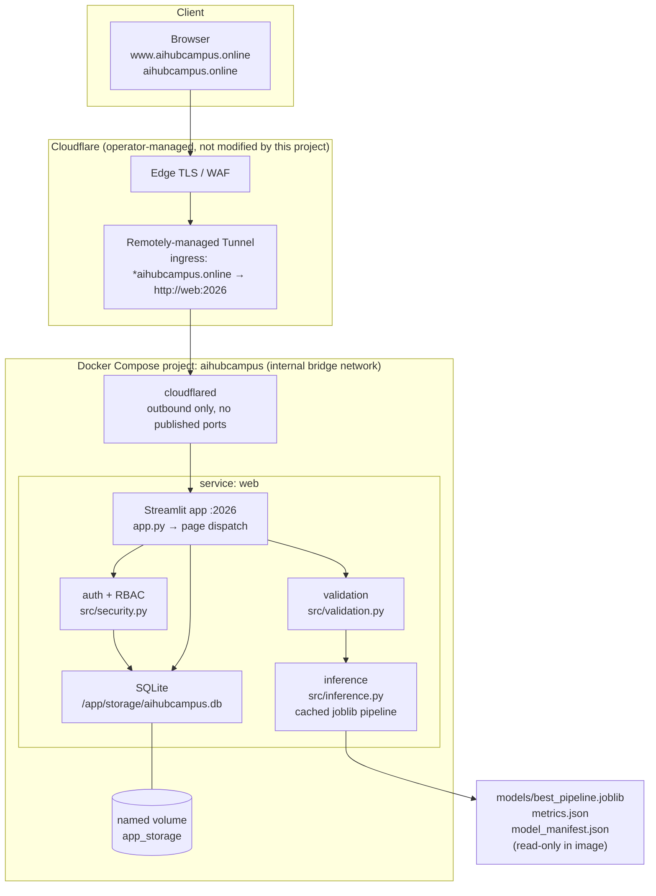

# Architecture — AI Hub Campus credit card default risk prediction

Status: **design frozen in Sprint 0**; no application code exists yet. Anything here
describing behaviour is a specification, not a claim that it runs. Deviations from
`blueprint.md` are recorded in §9.

## 1. Purpose and boundary

A single-instance academic decision-support web application. A signed-in user submits
23 historical attributes of a credit-card account and receives a binary next-month
default prediction, an uncalibrated model probability, a display tier and supportive
recommendations. Admins manage users, dataset versions and view the real ML evidence.

Explicitly **not** in scope: automated lending decisions, credit scoring, customer
contact, real customer data, registration, email, multi-tenant hosting. Historical
Taiwanese 2005 data, amounts in **NTD**, no claim of fitness for current Malaysian
lending.

## 2. Runtime topology



Text form (for reviewers without a Mermaid renderer):

```text
Browser --HTTPS--> Cloudflare edge --> remotely-managed tunnel (outbound only)
        --> cloudflared container --internal network--> web:2026 (Streamlit)
        --> session/RBAC guard + 23-field validation
        --> cached joblib Pipeline (fixed feature order) --> class + predict_proba
        --> tier/recommendation mapping --> SQLite (users, dataset_versions,
            prediction_logs, audit_events, schema_migrations)
```

Offline / reproducible ML path (no runtime training):

```text
data/UCI_Credit_Card.csv --validate(S2)--> EDA(S3) --> stratified 80/20 split(S4)
  --> 3 pipelines (LR, DT depth 5, RF 100×depth 5) --> held-out evaluation(S4)
  --> selected artifact + metrics.json + manifest(S5) --> app loads read-only(S5+)
```

## 3. Components and responsibilities

| Component | Path | Responsibility | Sprint |
|---|---|---|---|
| Entry point / dispatch | `app.py` | Navigation, session check on every route | S1/S6 |
| Config | `src/config.py` | Typed env settings, no defaults for secrets | S1 |
| DB layer | `src/db.py` | SQLite connection, WAL, idempotent migrations | S6 |
| Security | `src/security.py` | Argon2id/bcrypt hashing, session, RBAC, login throttling | S6 |
| Validation | `src/validation.py` | 23-field contract, CSV schema/ranges | S2/S5 |
| Inference | `src/inference.py` | Load manifest-verified pipeline once, predict | S5 |
| Recommendations | `src/recommendations.py` | Deterministic tier → advice mapping | S5 |
| Dataset manager | `src/data_manager.py` | Quarantine, checksum, version, activate | S9 |
| Charts | `src/charts.py` | Render saved EDA/performance figures | S10 |
| Audit | `src/audit.py` | Append non-sensitive admin events | S8 |
| ML scripts | `ml/*.py` | Inspect, EDA, train, evaluate, verify artifact | S0/S2–S5 |

Single instance of app + SQLite by design: avoids concurrent-session ambiguity on a
school demo. No horizontal scaling, no external queue, no second datastore.

## 4. Technology choices

| Layer | Choice | Why | Rejected |
|---|---|---|---|
| Runtime | Python 3.12 (pinned base image) | Streamlit/scikit-learn support, reproducible | Node/Next.js (no-go) |
| UI | Streamlit, pinned release | Fast multipage academic UI, Python-native | React SPA, FastAPI split backend (no-go) |
| ML | scikit-learn `Pipeline`, joblib | Leakage-safe preprocessing, single artifact | TensorFlow/LLM/paid APIs (no-go) |
| Data/EDA | pandas, NumPy, matplotlib | Standard, regenerable plots | Notebook-only deliverable (brief §10 forbids) |
| Storage | SQLite on a named volume | Zero-ops, sufficient for one instance | PostgreSQL, Redis (no-go) |
| Auth | `argon2-cffi` (bcrypt fallback) | Modern hashing, constant-time verify | Bare SHA-256 (prohibited by blueprint §12.2) |
| Tests | pytest + Streamlit `AppTest` | Objective gates, runnable in CI | Manual-only verification |
| Deploy | Docker Compose + `cloudflare/cloudflared` | Reproducible, no public port | Kubernetes (no-go), host port exposure (no-go) |

Exact pins land in `requirements.txt` at S1; this table records intent only.

## 5. Ingress resolution — the port 2026 decision

**The fact.** The operator's Cloudflare tunnel already publishes **both**
`www.aihubcampus.online` and `aihubcampus.online` to **`http://web:2026`**. `blueprint.md`
§2/§7 instead specify `http://web:8501`, and its compose file, healthcheck and Dockerfile
command hard-code 8501.

Provenance: operator report on issue RIDEGAMI-798, repeated in the operator's own record
(`PROJECT_DETAILS.md`, git-ignored): both hostnames → `http://web:2026`, default 404. It is
**not independently verified in S0** — the tunnel is remotely-managed, no local ingress
config exists (`~/.cloudflared` is empty), and inspecting it would need Cloudflare API
credentials.
S0 therefore treats the ingress as immutable and unverified, and S13 confirms it against
the live domain.

**Options considered.**

| Option | What it needs | Verdict |
|---|---|---|
| A. Serve Streamlit on **2026** | App port changed in one place; no Cloudflare change | **Chosen** |
| B. Keep 8501, edit the tunnel route to `http://web:8501` | Cloudflare dashboard/DNS change | Rejected — DNS/tunnel modification is out of scope and unauthorised |
| C. Keep 8501, add a proxy container mapping `web:2026 → web:8501` | An extra container and a second failure point | Rejected — complexity for no benefit |

**Decision (A).** The application serves on **2026**:

- `APP_PORT=2026` is the single source of truth; `.streamlit/config.toml`
  (`server.port`), the Dockerfile `CMD`, `EXPOSE`, the compose `expose:` entry and the
  healthcheck URL all derive from it. Reconciling to 8501 at S13, if the observed ingress
  turns out to be 8501, is a one-value change in `.env`, not a refactor.
- The compose **service name stays `web`** because the ingress target is the Docker DNS
  name `web`. Renaming it would break the route.
- `expose: 2026` only. **No `ports:` section** — no public host port, ever.
- The healthcheck hits `http://127.0.0.1:2026/_stcore/health`.

**Apex and www.** Both hostnames reach the same service, so the app must not assume one
canonical host:

- Do **not** pin `browser.serverAddress`; Streamlit derives it from the request `Host`
  header, which keeps XSRF/CORS origin checks correct for whichever name is used.
- No apex→www redirect is needed or configured (Cloudflare already routes both).
- S13 must test login, upload and a prediction over **both** hostnames.

**Risk if the report is wrong.** If the real route is `8501`, the symptom is a 502/1033
at the edge while the container is healthy. S13 detects it in one curl; the fix is the
`APP_PORT` value. Nothing else in the design depends on the number.

## 6. Data flow and storage

- `users(id, username UNIQUE, display_name, password_hash, role CHECK(admin|user),
  is_active, created_at, updated_at, last_login_at)`
- `prediction_logs(id, user_id, predicted_class, default_probability, risk_tier,
  model_version, created_at)` — **no raw feature snapshot** by default; history is
  pseudonymous by user ID.
- `dataset_versions(id, original_filename_safe, sha256 UNIQUE, record_count,
  column_count, class_zero, class_one, validated_at, activated_at, is_active,
  uploaded_by, status)` — exactly one active row, enforced in a transaction.
- `audit_events(id, actor_user_id, action, entity_type, entity_id, created_at,
  non_sensitive_details)`
- `schema_migrations(version, applied_at)`
- DB at `/app/storage/aihubcampus.db` on the `app_storage` volume; WAL + busy timeout.
- Model artifacts are baked read-only; the app never writes `models/`.

## 7. Data sensitivity and threat model

**Assets.** Operator credentials (admin password, session secret, tunnel token) ·
password hashes · prediction logs · dataset versions · the model artifact · the SQLite
file · the Cloudflare tunnel identity.

**Data sensitivity.** The benchmark dataset is public, aggregated, 2005-era and
**pseudonymous** — `ID` is a sequential index, not a customer identifier. That lowers
dataset risk but not system risk: the app stores credentials and behavioural logs. No
real customer record may ever be entered into the form; demo rows are synthetic and
labelled.

**Actors.** Anonymous internet user · authenticated User · Admin · operator (host +
Cloudflare) · the model artifact supply chain.

| # | Threat | Vector | Control | Residual |
|---:|---|---|---|---|
| T1 | Credential stuffing / brute force on login | Public login form | Argon2id hashes, constant-time verify, SQLite-backed attempt counter with expiry, generic error text | No MFA (out of scope); rate limit is per-instance |
| T2 | Privilege escalation User → Admin | Direct URL / forged session state | Server-side session + role check inside **every** privileged function, not just navigation; `Streamlit` session state is never the sole authority | None accepted; verified by T03 |
| T3 | Session hijack | Cookie theft over shared device | Signed session, expiry, logout invalidation, `enableXsrfProtection=true`, HTTPS only via tunnel | No device binding |
| T4 | Secret disclosure | Logs, `docker inspect`, git, screenshots | Secrets only in operator `.env` (mode 600, git-ignored); never logged or echoed; redaction in evidence; `git grep` gate | Host root can read env — accepted, host is single-tenant |
| T5 | Malicious CSV upload | Admin dataset upload | Size cap (10 MB), extension + MIME + **parse/schema** validation, quarantine path with generated filename, never executed, never auto-retrains | Admin is trusted; upload is still non-executable |
| T6 | Untrusted model artifact | Replacing `joblib` | Artifacts built only by trusted repo code; manifest + checksum verified at load; no upload path for pickles | Supply-chain risk in pinned packages |
| T7 | SQL injection | Any DB access | Parameterised queries only | — |
| T8 | Public origin exposure | Direct port access bypassing Cloudflare | `expose:` only, no `ports:`; single internal network; no host bind | Host-level firewall is the operator's control |
| T9 | Data exfiltration via prediction history | User reads others' rows | Queries filtered by session user ID server-side; admin sees aggregates, not raw features | Admin is trusted by design |
| T10 | Unfair or harmful output | Demographic features driving advice | Outputs framed as supportive, human-review-first; demographic ablation discussed in the report; no automated adverse action; disclaimer on every result | Fairness is **not** proven — must be stated as a limitation |
| T11 | Log leakage of sensitive input | Debug logging of 23 features | Never log submissions, credentials, hashes, cookies or tokens; 30-day retention default | — |
| T12 | Denial of service / cost | Public form abuse | Cloudflare edge protection; single instance is intentionally not HA | Availability is best-effort for an academic demo |

**Compliance stance.** No personal data is collected from users beyond a username;
no identity or banking account data is requested. The dataset is public and cited. The
system is a teaching artefact, not a regulated credit-decision system, and says so on
every screen.

## 8. Scope exclusions (binding)

No Next.js/React, no separate FastAPI backend, no PostgreSQL, no Redis, no Kubernetes,
no Celery, no LLM, no paid ML APIs, no registration/email, no training during a
prediction request, no `pickle`/`joblib` uploads, no public host port, no DNS or tunnel
change by this project, no writes outside `/home/ec-user/non_prod/hafyz_ds`, no Docker
project other than `aihubcampus`.

## 9. Deviations from `blueprint.md` (recorded as required by §3)

| # | Blueprint says | This project does | Why |
|---:|---|---|---|
| D1 | App on `:8501`, healthcheck on 8501 | `APP_PORT=2026` everywhere | Observed ingress targets `web:2026` (§5) |
| D2 | Password hashing "argon2-cffi **or** bcrypt" | Argon2id via `argon2-cffi` | One algorithm, one code path, easier to test |
| D3 | `PAY_1` implied by "six status columns" naming | `PAY_0, PAY_2…PAY_6` exactly as the CSV | The dataset has no `PAY_1`; inventing one would break the contract |
| D4 | Dataset described as all-integer monetary columns | Monetary columns read as float-safe, whole-NTD values | 4,262 cells use scientific notation (see `docs/report_evidence.md`) |
| D5 | Six EDA plots as a fixed list | Same six; captions must state the actual observed numbers | Draft's education "others" figure was wrong (C7) |

## 10. Open decisions deferred to later sprints

- Exact Streamlit/sklearn pins (S1) — must be compatible with Python 3.12.
- Whether the optional `127.0.0.1:2026` troubleshooting bind is enabled (S12, off by default).
- Model selection if reproduction differs from the draft's Decision Tree (S4) — decided on
  F1 and default-class recall, never accuracy alone.
- Backup/restore drill mechanics (S12).
